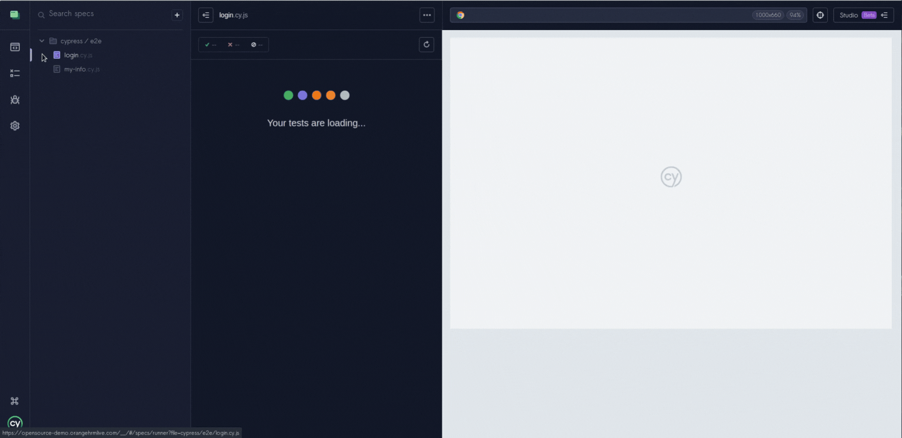
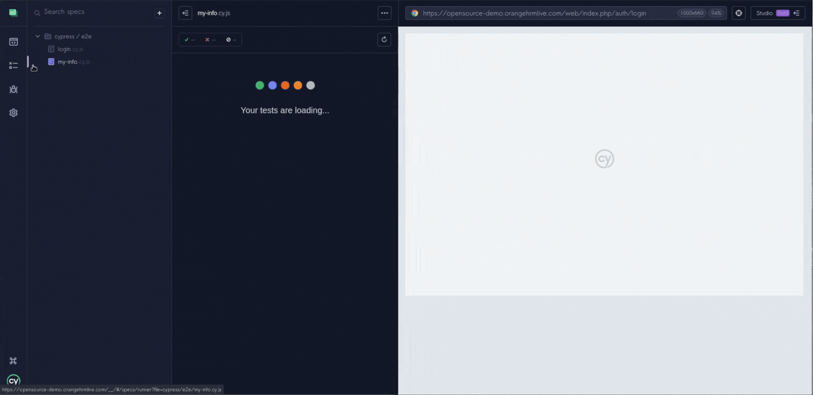

# Cypress End-to-End Test Automation — OrangeHRM

---

## Test Automation Project

This repository contains automated end-to-end test scenarios developed using Cypress and JavaScript, focusing on authentication and employee personal information workflows in OrangeHRM.

The project uses the OrangeHRM public demo environment to practice automated testing against a web-based Human Resource Management (HRM) application.

The goal is to demonstrate practical experience with test automation, including positive and negative scenarios, form validation, UI interactions, and test organization using the Page Object Model (POM) design pattern.

---

## About OrangeHRM

OrangeHRM is a Human Resource Management platform designed to support employee information management and HR-related operations.

The public demonstration environment provides access to different application modules, including employee profiles, personal details, contact information, and administrative functions.

This project focuses on two functional areas:

- **Authentication:** User login and credential validation.
- **Personal Information:** Employee profile navigation, field interactions, required-field validation, and contact information.

Application under test:

https://opensource-demo.orangehrmlive.com/

---

## Testing Approach

The automation strategy focuses on validating selected user workflows through browser-based end-to-end testing.

Tests are organized into two specifications according to their functional responsibilities.

The project implements the Page Object Model (POM) pattern to separate page interactions from test scenarios, improving code readability, reusability, and maintainability.

The tests cover successful operations, invalid input handling, mandatory-field validation, and navigation between application sections.

---

## Technologies Used

- Cypress 15.14.0
- JavaScript
- Node.js
- npm
- Page Object Model (POM)

---

## Test Scenarios Covered

### Authentication — `login.cy.js`

- **CT-01 — Valid Login:** Verifies successful authentication with valid credentials and access to the dashboard.
- **CT-02 — Invalid Login:** Confirms that invalid credentials are rejected and the corresponding error message is displayed.
- **CT-03 — Required Login Fields:** Validates mandatory-field error messages when attempting to log in with empty fields.

### Personal Information — `my-info.cy.js`

- **CT-04 — Access Personal Details:** Verifies navigation to the My Info section and visibility of personal information fields.
- **CT-05 — Edit Personal Details Fields:** Validates interactions with editable first-name and last-name fields.
- **CT-06 — Required Personal Details Fields:** Confirms that mandatory personal information fields display validation errors when cleared.
- **CT-07 — Access Contact Details:** Verifies navigation to the Contact Details section.
- **CT-08 — Contact Information Fields:** Confirms the visibility of selected address, telephone, and email field labels.

---

## Demonstrated Test Scenarios

The following demonstrations show the automated Cypress test executions organized by functional area.

Each GIF illustrates a complete specification containing multiple related test cases.

### Authentication — CT-01 to CT-03

Validates successful login, rejection of invalid credentials, and mandatory login field validation.



### Personal Information — CT-04 to CT-08

Demonstrates employee profile navigation, personal information field interactions, required-field validation, and access to contact information.



---

## Project Structure

The automation project separates test specifications, page objects, supporting files, and visual documentation.

```text
orangehrm-cypress-tests/
├── cypress/
│   ├── e2e/
│   │   ├── login.cy.js
│   │   └── my-info.cy.js
│   ├── fixtures/
│   ├── pages/
│   │   ├── LoginPage.js
│   │   └── MyInfoPage.js
│   └── support/
│       ├── commands.js
│       └── e2e.js
├── docs/
│   └── gifs/
│       ├── Login_CT-01_CT-02_CT-03.gif
│       └── my-info_CT-04_CT-05_CT-06_CT-07_CT-08.gif
├── .gitignore
├── cypress.config.js
├── package-lock.json
├── package.json
└── README.md
```

The main directories have the following responsibilities:

- **e2e:** Contains the automated end-to-end test specifications.
- **pages:** Encapsulates application interactions using Page Object Model classes.
- **fixtures:** Reserved for reusable test data.
- **support:** Contains Cypress support configuration and custom commands.
- **docs/gifs:** Stores visual evidence of automated test execution.

---

## How to Run the Tests

The automated tests execute against the publicly available OrangeHRM demo application.

Unlike locally hosted applications, the OrangeHRM demo does not require a separate application server to be installed or started.

### Prerequisites

- Git
- Node.js and npm
- Google Chrome
- Internet connection

### 1. Clone the test repository

Clone this repository and navigate to the project directory.

### 2. Install dependencies

```bash
npm install
```

### 3. Execute the automated tests

Run the complete test suite using Google Chrome:

```bash
npm test
```

This command executes both specifications in headless mode.

### 4. Open Cypress interactively

To execute or inspect the tests through the Cypress Test Runner:

```bash
npm run cy:open
```

Alternatively, run the suite using the Cypress configured/default browser:

```bash
npm run cy:run
```

The public OrangeHRM demo environment may contain shared or changing test data. Execution results can therefore vary depending on application availability and the current state of the environment.

---

## Test Execution Results

The complete test suite was successfully executed through the terminal using:

```bash
npm test
```

**Validated execution — October 23, 2026**

| Specification | Test Cases | Passed | Failed |
|---|---:|---:|---:|
| `login.cy.js` | 3 | 3 | 0 |
| `my-info.cy.js` | 5 | 5 | 0 |
| **Total** | **8** | **8** | **0** |

**Execution environment:** Google Chrome

**Total duration:** 56 seconds

**Result:** All 8 tests passed.

These results represent the verified execution and do not guarantee identical outcomes in subsequent runs against the shared demo environment.

---

## Test Coverage

The project provides automated coverage for selected user interactions within OrangeHRM:

- Authentication with valid credentials
- Authentication rejection with invalid credentials
- Mandatory login field validation
- Access to employee personal details
- Editing interactions with personal information fields
- Mandatory employee-name field validation
- Navigation to employee contact details
- Visibility of contact information fields

The current suite focuses on UI behavior and functional validation. It does not claim comprehensive coverage of all OrangeHRM modules or employee management operations.

---

## Automation Strategy

The project follows a modular automation approach based on the Page Object Model.

Key aspects include:

- Separation of authentication and personal information specifications
- Reusable page interaction methods
- Centralized UI navigation logic
- Positive and negative test coverage
- Assertions for navigation, visibility, input values, and validation messages
- Visual documentation through Cypress execution GIFs
- Reproducible execution through npm scripts

This approach supports code maintainability while providing a practical foundation for expanding automated coverage into additional OrangeHRM workflows.

---

## Project Purpose

This repository is part of a practical QA automation portfolio focused on developing technical skills in Cypress, JavaScript, browser-based testing, and test architecture.

It demonstrates the implementation of automated functional tests against an existing web application, with emphasis on clear test responsibilities, reusable page objects, and verifiable execution results.